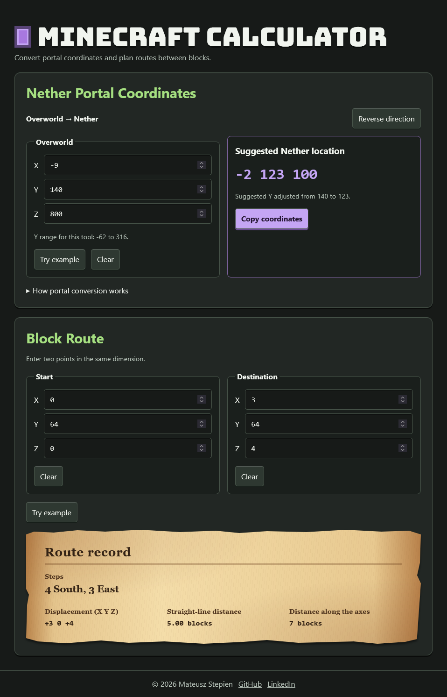

# Minecraft Calculator

_A lightweight Minecraft toolkit for calculating Nether portal coordinates and optimal block routes._

## [Open the calculator ↗](https://MateuszS6.github.io/Minecraft-Calculator/)

- **Nether Portal Coordinates** converts coordinates in both directions between the Overworld and Nether.
- **Block Route** shows movement directions, displacement, straight-line distance, and distance along the axes.
- Ideal for players who want quick, accurate in-game calculations without installing mods.

## Preview

Original design (v1.0)

## Stack

